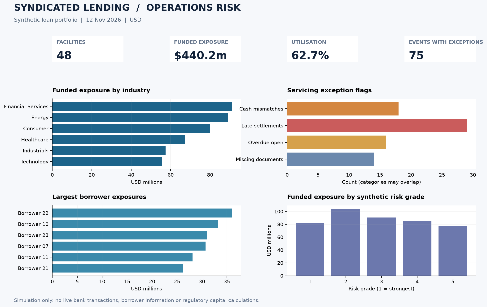

# Syndicated Lending Operations & Credit Risk Analytics

**Independent portfolio project** · Python · SQL · pandas · Matplotlib · Operational risk controls · Middle-office analytics



> **Synthetic dataset, not client data.** Every borrower, credit facility, loan-servicing event and risk grade is invented. This is an independently developed portfolio case study — **not** a university-assessed Exeter MSc capstone, real Goldman Sachs work, or production credit-risk model.

## Executive summary

Developed a reproducible analytical workflow to investigate simulated syndicated lending facilities and associated servicing events. The project validates primary/foreign keys and utilisation values, flags cash breaks, delayed settlement, incomplete documentation and open overdue events, and produces a prioritised exception queue and portfolio dashboard.

The operational question: **Where should a middle-office analyst prioritise attention across a lending portfolio?**

## Results — synthetic snapshot as of 12 November 2026

| Metric | Result |
|---|---:|
| Loan facilities | **48** |
| Servicing events (drawdown, repayment, interest, fees) | **336** |
| Total commitments | **$702.0m** |
| Funded exposure (commitment × utilisation) | **$440.2m** |
| Portfolio utilisation | **62.71%** |
| Servicing events with at least one exception | **75** |
| Cash mismatches | **18** |
| Late settlements | **29** |
| Overdue open events | **16** |
| Missing-document events | **14** |
| Facilities maturing in 12 months | **12** |
| Top-five borrowers' share of funded exposure | **36.16%** |

**Interpretation:** 75 unique events warrant review. Individual exception categories **overlap**, so their counts must not be summed. Prioritise overdue unsettled events and reconciliation breaks, then document remediation and upcoming maturity monitoring. These are simulated workflow priorities, not live banking findings.

## Dashboard

The chart above is **generated by the Python analysis**, not fabricated. GitHub Actions regenerates and commits the screenshot to `assets/screenshots/portfolio_dashboard.png` after the initial push, so the image displays directly on this GitHub page.

## Repository structure

```text
.
├── .github/workflows/tests.yml       # CI tests; dashboard publishing
├── assets/screenshots/
│   └── portfolio_dashboard.png        # Workflow-generated visual
├── data/
│   ├── facilities.csv                 # 48 synthetic facilities
│   └── servicing_events.csv           # 336 synthetic events
├── sql/loan_operations.sql            # SQL exposure, exceptions and maturity
├── src/analyze.py                     # Analytics, validation and chart
├── tests/test_analytics.py            # 5 automated unit tests
├── requirements.txt
├── LICENSE
└── README.md
```

## Reproduce on your computer

Requires Python 3.10+.

```bash
python -m pip install -r requirements.txt
python -m unittest discover -s tests -v
python src/analyze.py
```

Expected output files are written to `output/`: `summary.json`, `facility_risk.csv`, `exception_queue.csv`, `portfolio_dashboard.png`. The `output/` folder is excluded from Git because it is regenerable.

## Business definitions

- **Funded exposure:** credit commitment × utilisation %. This is not regulatory Exposure at Default or expected credit loss.
- **Cash mismatch:** a settled event with absolute payment variance > $1.
- **Late settlement:** actual settlement later than contractual due date.
- **Overdue open:** no settlement recorded and due date before fixed reporting date, 2026-11-12.
- **Missing documentation:** `docs_complete = 0`.
- **Next-year maturity:** facility matures between 2026-11-12 and 2027-11-12.
- **Risk rating:** entirely invented five-point ordinal field, not a rating agency grade.

## Business relevance

This case study develops skills related to syndicated loan middle-office operations: transaction exceptions, reconciliation, portfolio exposure, operational risk, data validation, control reporting and documentation completeness.

**Limits:** No live syndicate allocations, credit agreement interpretation, agent notifications, SOFR/SONIA accruals, multi-currency conversions, covenant monitoring, loan system integration, regulatory PD/LGD/EAD estimation or audited financial reporting. SQL queries use SQLite-compatible syntax.

## Tests and evidence

The five tests validate exception classification, exposure calculation, orphaned event rejection, duplicate event rejection, invalid utilisation rejection and clean-event handling. A GitHub Actions run executes tests and analysis; generated output is uploaded as a build artifact. The latest result is shown in the **Actions** tab.

## Interview-ready explanation

"I developed an independent, synthetic syndicated-loan analytics project to understand servicing controls and the day-to-day decisions a middle-office team faces. I validated data, flagged reconciliation and settlement breaks, built an exception queue and visualised borrower concentration. I can explain every rule in the analysis, but this project does not mean I have processed real syndicated loans."

## Licence

MIT. The examples contain no confidential or proprietary information.
